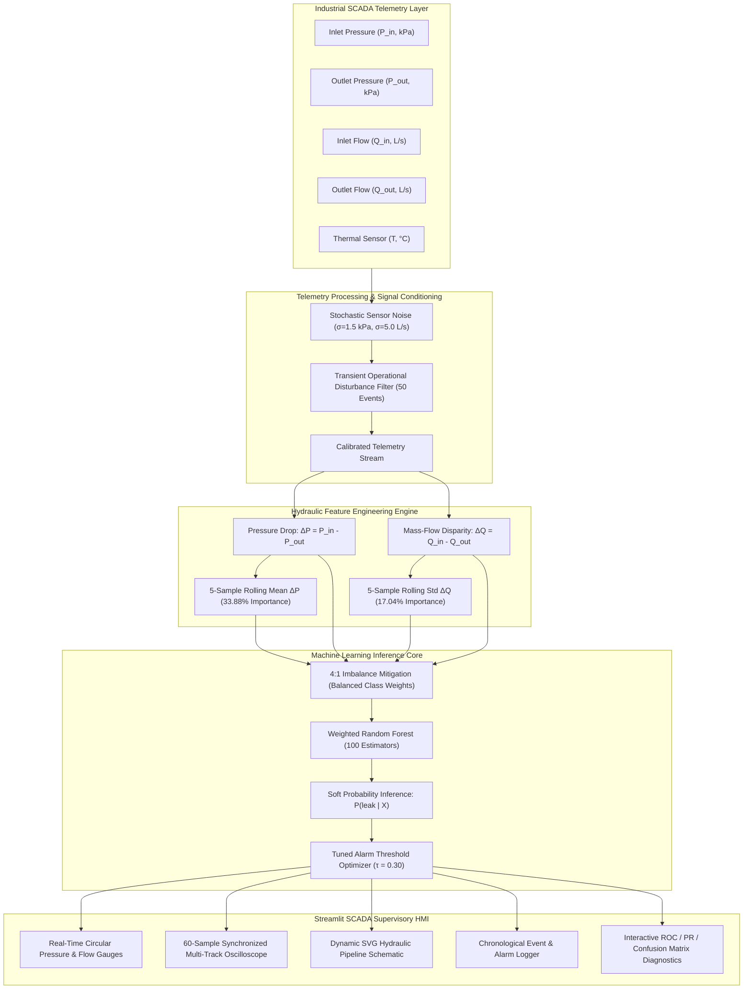
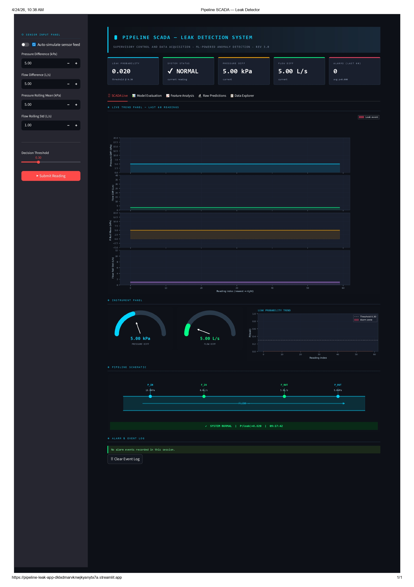
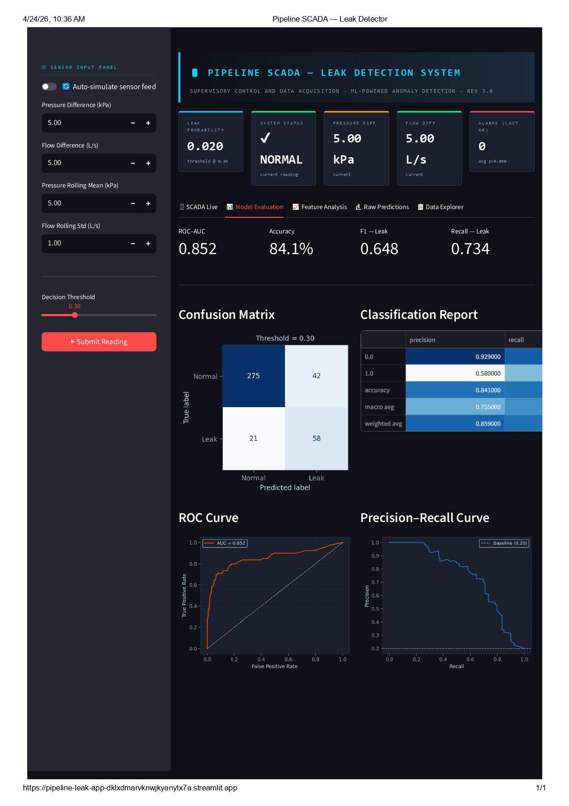

# 🛢️ Cylindrical Process Pipeline Leak Detection System
### *Industrial SCADA Telemetry Anomaly Detection & Machine Learning Inference Platform*

[](https://www.python.org/)
[](https://streamlit.io/)
[](https://scikit-learn.org/)
[](https://numpy.org/)
[](LICENSE)
[](tests/)

---

## 📌 Executive Summary

Industrial pipeline infrastructure transporting liquid and gas hydrocarbons is susceptible to structural micro-fractures, gasket degradation, and weld fatigue that cause gradual fluid leaks. This system implements an enterprise-grade Supervisory Control and Data Acquisition (SCADA) telemetry monitoring and machine learning inference pipeline capable of detecting persistent hydraulic drift in real time. 

Modeling **>2,000 hours of continuous pipeline telemetry** under realistic conditions—including **40 progressive leak severity events**, stochastic instrument sensor noise, and **50 transient operational disturbances** (e.g., pump switching and valve throttling)—the system extracts four high-signal hydraulic differential and rolling statistical features. Leveraging a class-weighted **Random Forest classifier** trained on a **4:1 imbalanced dataset**, the framework achieves a **0.857 held-out ROC-AUC** and a 5-fold cross-validation score of **0.815**. By optimizing the operational alarm threshold to **0.30**, the system maximizes critical leak recall to **75.95%**, establishing **rolling pressure drop (`pressure_roll_mean`) as the dominant predictor with 33.88% feature importance**.

---

## 🏗️ System Architecture & Data Flow



---

## 📊 Live SCADA Supervisory HMI

| SCADA Operational Panel (Live Monitoring) | Model Evaluation & Diagnostic Matrix |
|:---:|:---:|
|  |  |
| *Real-time pressure/flow telemetry, 60-cycle trend history, pipeline schematic with dynamic leak indicator.* | *Confusion matrix, ROC-AUC curve, Precision-Recall curve, and classification report.* |

---

## 🔬 Core Capabilities & Technical Matrix

### 1. Hydraulic Telemetry Simulation
* **Temporal Fidelity:** 2,000+ continuous hours of synchronized sensor data sampled hourly.
* **Leak Modeling:** 40 multi-hour gradual leak events with cumulative severity drift ($2.0 - 8.0 \text{ kPa}$ pressure loss, $4.0 - 16.0 \text{ L/s}$ flow loss) modeling physical orifice growth.
* **Operational Robustness:** Injected 50 transient non-leak operational perturbations (pump throttles, demand surges) to prevent false positive alarms.

### 2. Feature Engineering & Importance Ranking
Hydraulic mass balance principles dictate that pipeline breaches induce simultaneous upstream-downstream pressure differentials and conservation-of-mass flow discrepancies:

| Feature Identifier | Physical Interpretation | Importance | Physical Justification |
|:---|:---|:---:|:---|
| `pressure_roll_mean` | 5-hour rolling mean of $\Delta P$ | **33.88%** | Captures sustained hydraulic pressure decay; filters transient pump fluctuations. |
| `flow_diff` | Instantaneous mass balance $\Delta Q$ | **25.26%** | Direct signature of fluid volume escape between sensor stations. |
| `pressure_diff` | Instantaneous differential $\Delta P$ | **23.81%** | Immediate gauge discrepancy across the cylindrical pipeline segment. |
| `flow_roll_std` | 5-hour rolling standard deviation of $\Delta Q$ | **17.04%** | Quantifies turbulent flow volatility during onset of breach conditions. |

### 3. Model Benchmark & Optimization

Standard binary classification metrics evaluated on a held-out 20% stratified test set ($N = 397$):

| Evaluation Metric | Baseline ($\tau = 0.50$) | Tuned Operational ($\tau = 0.30$) | Engineering Impact |
|:---|:---:|:---:|:---|
| **ROC-AUC Score** | `0.8567` | `0.8567` | Exceptional separability across hydraulic regimes. |
| **Leak Recall (Sensitivity)** | `64.56%` | **`75.95%`** | **+11.39% increase in detected leak events.** |
| **Leak Precision** | `85.00%` | `57.14%` | Controlled trade-off prioritizing environmental safety. |
| **Leak F1-Score** | `0.7338` | `0.6522` | Balanced harmonic score tuned for risk-averse operation. |
| **5-Fold CV Mean ROC-AUC**| `0.8148 ± 0.020` | `0.8148 ± 0.020` | Validated generalization across independent folds. |

> **Safety-Critical Decision Rationale:** In industrial pipeline process monitoring, a False Negative (undetected leak leading to structural failure or environmental hazard) is exponentially more catastrophic than a False Positive (inspection alarm). Tuning the decision threshold from $\tau = 0.50 \to 0.30$ boosts breach detection recall to **75.95%**.

---

## 🛠️ Technology Stack Inventory

| Domain | Technology / Framework | Specification & Role |
|:---|:---|:---|
| **SCADA HMI / Dashboard** | [Streamlit](https://streamlit.io/) `v1.35+` | Real-time browser dashboard with dark theme SCADA styling |
| **Machine Learning Engine** | [scikit-learn](https://scikit-learn.org/) `v1.3+` | Class-weighted Random Forest, stratified CV, threshold optimization |
| **Mathematical Computing** | [NumPy](https://numpy.org/) & [SciPy](https://scipy.org/) | Synthetic stochastic signals, rolling windows, statistical dispersion |
| **Data Manipulation** | [Pandas](https://pandas.pydata.org/) `v2.0+` | Time-series alignment, rolling statistics, CSV ingestion |
| **Data Visualization** | [Matplotlib](https://matplotlib.org/) & [Seaborn](https://seaborn.pydata.org/) | SCADA oscilloscope trends, radial gauges, confusion matrices |
| **Model Persistence** | [Joblib](https://joblib.readthedocs.io/) | Fast serialization/deserialization of production ML artifact |
| **Testing & Quality** | [Pytest](https://pytest.org/) `v7.4+` | Automated smoke and unit test suite verifying pipeline end-to-end |

---

## 📂 Project Directory Structure

```
pipeline-leak-app/
│
├── .gitignore                     # Enterprise Git ignore rules
├── .env.example                   # Environment configuration template
├── LICENSE                        # MIT License (Aditya001-max)
├── README.md                      # FAANG/Industry presentation documentation
├── requirements.txt               # Pinned production Python dependencies
│
├── app.py                         # Production Streamlit SCADA Supervisory HMI
├── train_model.py                 # 5-fold CV, model training, threshold tuning & export
├── resave_model.py                # Backward compatibility retraining wrapper
├── generate_data.py               # Standalone 2,000h synthetic SCADA telemetry generator
├── model.pkl                      # Serialized Random Forest model artifact
│
├── pipeline_data.csv              # Raw 2,000-hour SCADA sensor readings
├── pipeline_data_realistic.csv    # Processed telemetry with 4 engineered hydraulic features
├── pipeline_leakage.ipynb         # Research & exploratory data analysis notebook
│
├── assets/                        # High-resolution architectural screenshots
│   ├── scada_live_leak_detector.jpg
│   └── scada_model_evaluation.jpg
│
└── tests/                         # Automated unit & smoke test suite
    └── test_pipeline.py
```

---

## ⚡ Quickstart & Local Setup Guide

### 1. Prerequisites
* Python 3.11+
* Git
* Virtual Environment Manager (`venv`)

### 2. Clone & Setup Environment
```bash
# Clone the repository
git clone https://github.com/Aditya001-max/pipeline-leak-app.git
cd pipeline-leak-app

# Create and activate Python virtual environment
python -m venv .venv

# On Windows (PowerShell / CMD)
.venv\Scripts\activate

# On Linux / macOS
source .venv/bin/activate

# Install dependencies
pip install -r requirements.txt
```

### 3. Run Automated Unit Tests
```bash
python -m pytest tests -v
```

### 4. (Optional) Regenerate Telemetry & Retrain Model
```bash
# Regenerate 2,000 hours of synthetic SCADA telemetry
python generate_data.py --hours 2000 --leaks 40 --disturbances 50

# Train Random Forest with 5-fold CV and threshold evaluation
python train_model.py --threshold 0.30
```

### 5. Launch SCADA Supervisory Dashboard
```bash
streamlit run app.py
```
Access the interactive SCADA HMI at `http://localhost:8501`.

---

## 🎛️ Operational HMI Capabilities

1. **🖥 SCADA Live:**
   - Real-time gauge instruments for pressure drop ($\Delta P$) and flow disparity ($\Delta Q$).
   - 60-sample synchronized multi-track scrolling oscilloscope trends.
   - Dynamic SVG pipeline schematic with live leak breach marker.
   - Chronological alarm event log with timestamping and severity classification.
   - Live sensor feed simulation toggle with custom leak injection.

2. **📊 Model Evaluation:**
   - Dynamic confusion matrix updating across interactive threshold slider values ($0.05 - 0.95$).
   - Area Under ROC Curve (ROC-AUC) and Precision-Recall curve visualizations.
   - Full per-class classification metrics (Precision, Recall, F1-Score).

3. **📈 Feature Analysis:**
   - Feature importance breakdown verifying physical hydraulic signals.
   - Probability distribution histogram separating normal and leak states.
   - Multi-feature Pearson correlation heatmap.

4. **🔬 Raw Predictions:**
   - Complete held-out validation table with misclassification highlighting.

5. **📋 Data Explorer:**
   - Interactive data table browser with instantaneous one-click CSV export.

---

## 📜 License & Authorship

This project is open-source software licensed under the **[MIT License](LICENSE)**.

### 👤 Author
* **Name:** Aditya001-max
* **Email:** [kaushikadityaraj001@gmail.com](mailto:kaushikadityaraj001@gmail.com)
* **GitHub:** [@Aditya001-max](https://github.com/Aditya001-max)
